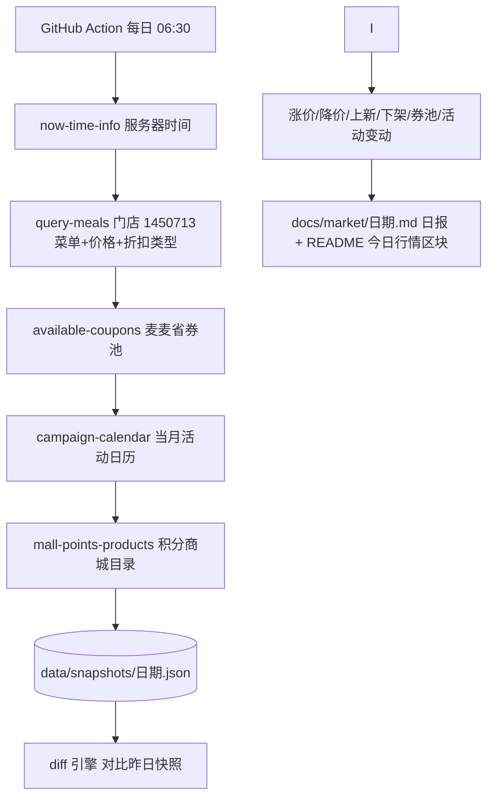

# MCP 集成说明 · MCP_INTEGRATION

本文档说明「麦麦研究所」**实际使用**的麦当劳 MCP 能力、调用流程与业务价值。所有工具清单与字段均来自对官方 MCP Server 的真实调用（2026-10-24 实测）。

## 一、使用的 MCP Server

| 项 | 值 |
|---|---|
| Server 名称 | `mcd-mcp`（麦当劳中国官方） |
| 接入地址 | `https://mcp.mcd.cn/mcp-servers/mcd-mcp` |
| 传输协议 | Streamable HTTP |
| 鉴权方式 | 请求头 `Authorization: Bearer <MCD_MCP_TOKEN>` |
| 会话 | initialize 成功后携带响应头 `Mcp-Session-Id` |
| 限流 | 600 次/分钟/Token（客户端对 429 做指数退避重试） |
| 配置示例 | [`mcp-config.example.json`](mcp-config.example.json)（仅含 `${MCD_MCP_TOKEN}` 环境变量占位符） |

Token 在 [open.mcd.cn/mcp](https://open.mcd.cn/mcp) 控制台申请；本地通过环境变量 `MCD_MCP_TOKEN` 注入，GitHub Actions 中存放于 Repository Secrets，仓库内不含任何真实凭证。

## 二、三个科室的调用流程

### 1. 行情部（`mcd_lab/snapshot.py` + `diff.py`）—— 每日行情日报

业务价值：把麦当劳菜单变成可追踪的「行情数据」——首次让用户能看到每日价格变动、上新下架、券池更替与活动日历增删。

### 2. 积分理财科（`mcd_lab/points.py`）—— 积分省钱榜 + 个人体检

- `mall-points-products`（积分商城目录，实测 50 个商品）× `query-meals`（菜单现金价）
  → 名称强匹配（菜单名去括号后 ≥3 字出现在券描述中，短名是长名子串时去重）
  → **每万积分省钱 = (菜单现价合计 − 兑换现金价) ÷ 积分 × 10000**
- 个人体检模式（`--me`，仅本地）：`query-my-account`（余额/本月将过期积分/累计）+ `query-lottery-info`（抽奖消耗规则与奖品池）→ 输出体检报告，引导快过期积分优先兑换高性价比券。

实测发现示例：500 积分解锁「22.9 元 2 份板烧鸡腿堡」，每万积分省钱约 ¥482，是同积分档巨无霸组合的 10 倍。

### 3. 考古部（`mcd_lab/archaeology.py`）—— 套餐组合空间考古

- 遍历 `query-meals` 返回的全部餐品，逐个调用 `query-meal-detail`
- 解析 `data.rounds[]`（选配轮次）× `choices[]`（选项，`isDefault`/`supportModify`）× `modification.items[].values[]`（特调：名称/价格(分)/最大份数）
- 产出：默认搭配 / 可替换项 / 0 元特调 / 付费特调 / 原始组合树 → 每餐一页图鉴 + 全场摘要
- 实测覆盖：63 款有选配空间的餐品，最大组合树 55 节点（全明星双人分享餐八件套）

### 价格核验（保证「价格必须真实」）

`calculate-price`（items 使用 `productCode` + `quantity`，**返回单位为分**）用于对图鉴中的关键组合实时核价，确保展示价格与官方一致；快照中的 `query-meals.currentPrice` 单位为元，两套单位在代码中统一换算。

## 三、使用的 Tool 清单（11 个）

| # | Tool | 科室 | 用途 |
|---|---|---|---|
| 1 | `now-time-info` | 行情部 | 服务器时间基准 |
| 2 | `query-meals` | 行情/考古/积分 | 菜单、价格、分类主数据 |
| 3 | `available-coupons` | 行情部 | 麦麦省可领券池（不含个人券码） |
| 4 | `campaign-calendar` | 行情部 | 当月活动日历 |
| 5 | `mall-points-products` | 积分科 | 积分商城目录 |
| 6 | `query-my-account` | 积分科(本地) | 积分余额与过期预警 |
| 7 | `query-lottery-info` | 积分科(本地) | 抽奖规则与奖品池 |
| 8 | `query-meal-detail` | 考古部 | 选配轮次×选项×特调 |
| 9 | `calculate-price` | 考古部 | 组合实时核价 |
| 10 | `query-nearby-stores` | 公共 | 门店定位（beType=1/searchType=2） |
| 11 | `query-promotions` | 预留 | 团餐促销规则（规划中） |

> **隐私边界（主动设计）**：实测发现 `query-store-coupons` / `query-my-coupons` 返回用户本人券包及**券码**，属个人敏感数据。本项目公共采集流程**不调用**这两个工具；涉及个人账户数据的 `--me` 模式仅在用户本地运行，结果不进入仓库。

> 本项目只调用只读类工具完成情报采集与分析，不自动领券、不创建订单、不消耗积分。

## 四、工程化细节（踩坑记录，供复用）

1. 工具返回 text = 官方 prompt 指引 + 内嵌业务 JSON，需从首个 `{"success"` 起用 `JSONDecoder.raw_decode` 截取；
2. notification（`notifications/initialized`）返回 202 空 body；
3. `calculate-price` 的 items 字段名是 `productCode`（非 `code`），否则返回 price=0；
4. `随心配` 类特殊商品 `query-meal-detail` 返回空 data，已在考古器中跳过；
5. `query-meals` 可不传 `reservationDate`（默认当前时刻），CI 中固定门店与时间窗以保证 diff 可比性；
6. 官方会无公告调整服务端工具集：2026-10-30 起 `mall-points-products` 返回 `unknown tool`，经 `tools/list` 枚举确认为**改名 → `query-mall-products`**（返回结构与字段完全不变；官方 README 文档滞后未更新）。快照器已改用新名并保留降级（缺失记空列表，日报其余板块照常出刊）。**接入同类服务请勿假设工具清单永远不变——单工具故障不应中断管道，必要时用 `tools/list` 枚举现役清单。**
